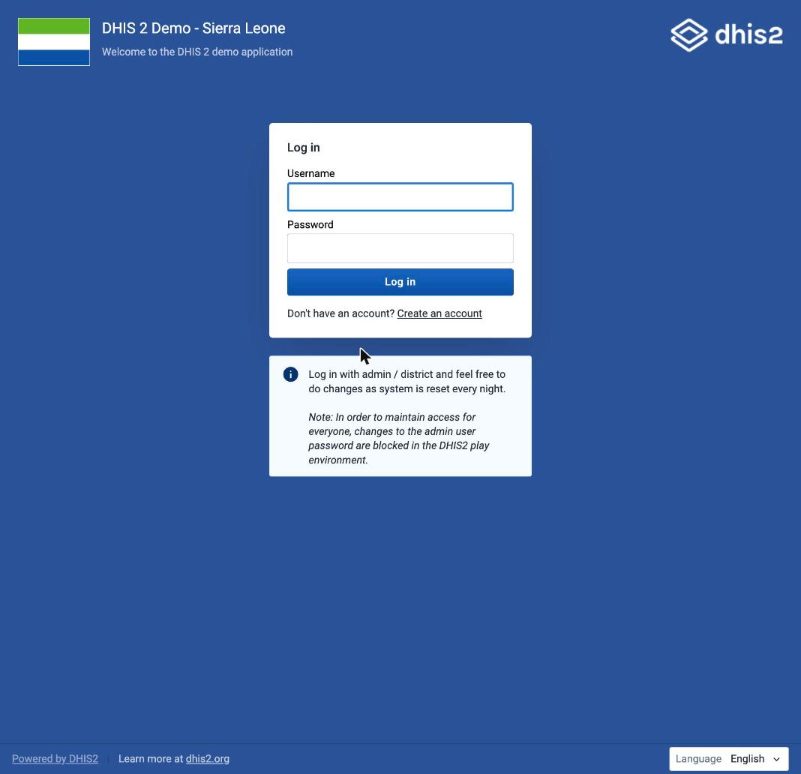
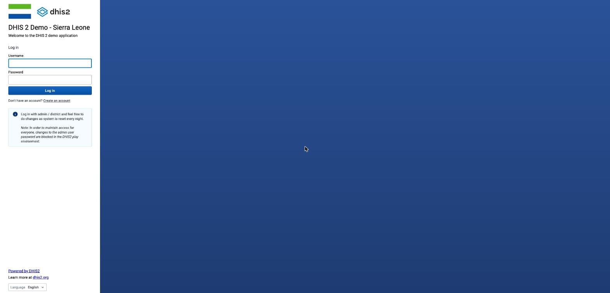

# Login app { #login_app }

The **Login** app is the page where you log in to DHIS2. It opens when you go to the address of a DHIS2 instance and you are not logged in.

This page describes what you need to log in, the layouts that the login page can use, and how administrators customize the login page in the **System Settings** app.

## Log in to DHIS2 { #login_app_log_in }

Before you start, make sure that you have the address of the DHIS2 instance and a user account on that instance. An administrator creates user accounts in the **Users** app. Some instances also let you create your own account (see [Self-registration and account recovery](#login_app_links)).

1. In your browser, open the address of your DHIS2 instance. The login page opens.
2. In the **Username** field, enter your username.
3. In the **Password** field, enter your password.
4. Click **Log in**.
5. If your account uses two-factor authentication, enter the code from your authenticator app or your email in the **Authentication code** field that opens, and click **Verify and log in**.

If your code comes by email and you did not receive it, click **Resend Code**.

After you log in, DHIS2 opens the start page that your administrator chose in the **Start page** setting (see [Appearance settings](system-settings-app.md#system_appearance_settings)).

## Login requirements { #login_app_requirements }

To log in, you must meet the requirements in the following table. Administrators control most of them in the **System Settings** app.

Table: Login requirements

| Requirement                        | Description                                                                                                                                                                                                                                                                                                                                                                                                                                                                                   | Controlled by                                                                                                                              |
| ---------------------------------- | --------------------------------------------------------------------------------------------------------------------------------------------------------------------------------------------------------------------------------------------------------------------------------------------------------------------------------------------------------------------------------------------------------------------------------------------------------------------------------------------- | ------------------------------------------------------------------------------------------------------------------------------------------ |
| User account                       | You need an account that an administrator created, or that you created with self-registration. If an administrator disabled your account, or your account expired, the login page shows the message **Your account has been disabled** or **Your account has expired**, and asks you to contact your system administrator.                                                                                                                                                                    | **Users** app                                                                                                                              |
| Username and password              | Your password must have at least the minimum number of characters that your administrator set. The minimum is 8, 10, 12, or 14 characters.                                                                                                                                                                                                                                                                                                                                                    | **Minimum characters in password** in [Access settings](system-settings-app.md#system_access_settings)                                     |
| Current password                   | If your administrator requires password changes, you must change your password every 3, 6, or 12 months. In Login app v100.5.0 and later, if your password expired, the login page links to a **Password expired** form where you enter your current password and choose a new one.                                                                                                                                                                                                           | **Require user account password change** in [Access settings](system-settings-app.md#system_access_settings)                               |
| Two-factor code                    | If you set up two-factor authentication, you must enter a code every time you log in. The code comes from an authenticator app (TOTP) or from an email, depending on how your administrator configured your instance. For how to set up two-factor authentication, see [Setting up two-factor authentication (2FA)](https://docs.dhis2.org/en/use/user-guides/dhis-core-version-master/working-with-your-account/set-user-account-preferences.html#setting-up-two-factor-authentication-2fa). | User profile, **Two Factor Authentication**                                                                                                |
| Verified email address             | If your administrator requires verified email addresses, you must verify your email address before you can access the system.                                                                                                                                                                                                                                                                                                                                                                 | **Enforce verified emails** in [Access settings](system-settings-app.md#system_access_settings) (v42 and later)                            |
| Account that is not locked         | If your administrator turned on account locking, DHIS2 locks your account for 15 minutes after five failed login attempts within 15 minutes, and the login page shows the message **Your account is temporarily locked**. After 15 minutes, you can try again.                                                                                                                                                                                                                                | **Lock user account temporarily after multiple failed login attempts** in [Access settings](system-settings-app.md#system_access_settings) |
| Login through an external provider | If your account is set to **External authentication only (OpenID or LDAP)**, you log in through the external provider and not with a DHIS2 password.                                                                                                                                                                                                                                                                                                                                          | **Users** app and server configuration (see [Log in with an external provider](#login_app_external))                                       |

#### v42 and earlier { #login_requirements_v42_and_earlier }

-   In v42 and earlier, the **System Settings** app does not have the setting **Enforce verified emails**, so you do not have to verify your email address before you log in.

#### v42 and later { #login_requirements_v42_and_later }

-   From v42, the **System Settings** app has the setting **Enforce verified emails** in the Access settings. When an administrator enables it, you must verify your email address before you access the system.

## Self-registration and account recovery { #login_app_links }

The login page shows two extra links when an administrator turns on the matching settings in the **System Settings** app. If the settings are off, the links do not appear.

Table: Optional links on the login page

| Link                                                                  | When it appears                                                                                                                                                   | Settings that control it                                                                                                                                                                      |
| --------------------------------------------------------------------- | ----------------------------------------------------------------------------------------------------------------------------------------------------------------- | --------------------------------------------------------------------------------------------------------------------------------------------------------------------------------------------- |
| **Create an account** (shown after the text "Don't have an account?") | When an administrator chooses a user role in **Self registration account user role** and an organisation unit in **Self registration account organisation unit**. | [Access settings](system-settings-app.md#system_access_settings)                                                                                                                              |
| **Forgot password?**                                                  | When an administrator enables **Enable user account recovery** and the instance can send email.                                                                   | **Enable user account recovery** in [Access settings](system-settings-app.md#system_access_settings), and the SMTP settings in [Email settings](system-settings-app.md#system_email_settings) |

## Login page layouts { #login_app_layouts }

The login page has three layouts. An administrator chooses the layout with the **Login page theme** setting in [Appearance settings](system-settings-app.md#system_appearance_settings).

Table: Login page layouts

| Layout  | Description                                                                                                                                                                                                                                                                                                                           | Use it when                                             |
| ------- | ------------------------------------------------------------------------------------------------------------------------------------------------------------------------------------------------------------------------------------------------------------------------------------------------------------------------------------- | ------------------------------------------------------- |
| Default | The standard layout. The flag, application title, and introduction are at the top left, and the logo is at the top right. The login box is in the center, with the application notification under it. The footer texts and the language menu are at the bottom. DHIS2 uses this layout until an administrator chooses another layout. | You want the standard page with your own text and logo. |
| Sidebar | A layout with a panel on the left side of the page. The panel holds the flag, the logo, the application title and introduction, the login box, the application notification, the footer texts, and the language menu. The rest of the page is a blue background.                                                                      | You want a different layout without writing any HTML.   |
| Custom  | A layout that you define with an HTML template. You paste the template in the **Login page template** setting.                                                                                                                                                                                                                        | You need full control of the layout and style.          |

### Choose a layout { #login_app_choose_layout }

You need access to the **System Settings** app.

1. Open the **System Settings** app.
2. Open the **Appearance** settings.
3. In **Login page theme**, choose **Default**, **Sidebar**, or **Custom**. The app saves your choice automatically.
4. If you chose **Custom**, paste your HTML in **Login page template**.
5. Open the login page in a private browser window to check the result.

## Customize the login page { #login_app_customize }

An administrator sets the text, logo, and other elements of the login page in the **System Settings** app. The following table shows which setting changes which part of the login page. For the full description of each setting, see [Appearance settings](system-settings-app.md#system_appearance_settings).

Table: Settings that change the login page

| Part of the login page                                          | Setting                                                                                     | Settings section                                                         |
| --------------------------------------------------------------- | ------------------------------------------------------------------------------------------- | ------------------------------------------------------------------------ |
| Application title at the top left                               | **Application title**                                                                       | [Appearance settings](system-settings-app.md#system_appearance_settings) |
| Introduction text at the top left, under the application title  | **Application introduction**                                                                | [Appearance settings](system-settings-app.md#system_appearance_settings) |
| Notification under the login area                               | **Application notification**                                                                | [Appearance settings](system-settings-app.md#system_appearance_settings) |
| Text in the left footer, next to the **Powered by DHIS2** link  | **Application left-side footer**                                                            | [Appearance settings](system-settings-app.md#system_appearance_settings) |
| Text in the right footer                                        | **Application right-side footer**                                                           | [Appearance settings](system-settings-app.md#system_appearance_settings) |
| Logo at the top right (the DHIS2 logo if you do not upload one) | **Custom login page logo**                                                                  | [Appearance settings](system-settings-app.md#system_appearance_settings) |
| Flag at the top left, next to the application title             | **Flag**                                                                                    | [Appearance settings](system-settings-app.md#system_appearance_settings) |
| Layout                                                          | **Login page theme**                                                                        | [Appearance settings](system-settings-app.md#system_appearance_settings) |
| Custom layout and style                                         | **Login page template**                                                                     | [Appearance settings](system-settings-app.md#system_appearance_settings) |
| Translations of the text settings                               | **Select language**                                                                         | [Appearance settings](system-settings-app.md#system_appearance_settings) |
| Self-registration link                                          | **Self registration account user role** and **Self registration account organisation unit** | [Access settings](system-settings-app.md#system_access_settings)         |
| Account recovery link                                           | **Enable user account recovery**                                                            | [Access settings](system-settings-app.md#system_access_settings)         |

To show text in more than one language, first set a default value for the setting. Then choose a language in **Select language** and enter the translation. For details, see [Appearance settings](system-settings-app.md#system_appearance_settings).

### Login popup { #login_app_popup }

The login page can show a message in a window that you must close with **I agree** before you log in. This window appears when the system setting `loginPopup` has a value. The **System Settings** app does not have a field for this setting, so an administrator sets it through the API. The value can contain HTML.

### Custom layout with an HTML template { #login_app_custom_template }

A custom template replaces elements of the login page by their HTML IDs, so you can combine your own layout (HTML) with your own style (CSS). Keep these points in mind:

-   The template must include the element with the ID `login-box`. This element is the login dialog, and the login app does not work as intended without it.
-   DHIS2 removes script tags from uploaded templates. A custom template cannot run scripts.
-   You can start from the default template or the sidebar template. Download them from your instance at `/login/#/download`, where you choose **Download default template** or **Download sidebar template**.
-   You can change the appearance of the login dialog with CSS variables that you define in the template.

The developer documentation lists all reserved IDs, the available CSS variables, and how to reset the layout through the API. See [Login App customization](https://docs.dhis2.org/en/develop/using-the-api/dhis-core-version-master/settings-and-configuration.html#login_app_customization).

## Log in with an external provider { #login_app_external }

If your administrator configured OpenID Connect (OIDC), the login page shows a button for each provider, for example **Log in with Google** or **Log in with Microsoft**. For other providers, the button text is the display alias that the administrator set in the provider configuration. After you click the button, you log in at the provider and DHIS2 logs you in automatically.

Each user who logs in through OIDC needs a DHIS2 user account with these values:

-   **External authentication only (OpenID or LDAP)** is checked in the user profile.
-   The **OpenID** field has the value that the provider sends, for example the email address of the person who logs in. The value is case-sensitive.

Administrators configure providers in the server configuration. For the steps, see [OIDC login: DHIS2 as a Relying Party](https://docs.dhis2.org/en/manage/reference/openid-connect-oidc.html#oidc_login).

## Related topics { #login_app_related }

-   [System Settings](system-settings-app.md)
-   [Appearance settings](system-settings-app.md#system_appearance_settings)
-   [Access settings](system-settings-app.md#system_access_settings)
-   [Email settings](system-settings-app.md#system_email_settings)
-   [Login App customization (developer guide)](https://docs.dhis2.org/en/develop/using-the-api/dhis-core-version-master/settings-and-configuration.html#login_app_customization)
-   [OIDC login](https://docs.dhis2.org/en/manage/reference/openid-connect-oidc.html#oidc_login)
-   [Setting up two-factor authentication (2FA)](https://docs.dhis2.org/en/use/user-guides/dhis-core-version-master/working-with-your-account/set-user-account-preferences.html#setting-up-two-factor-authentication-2fa)
